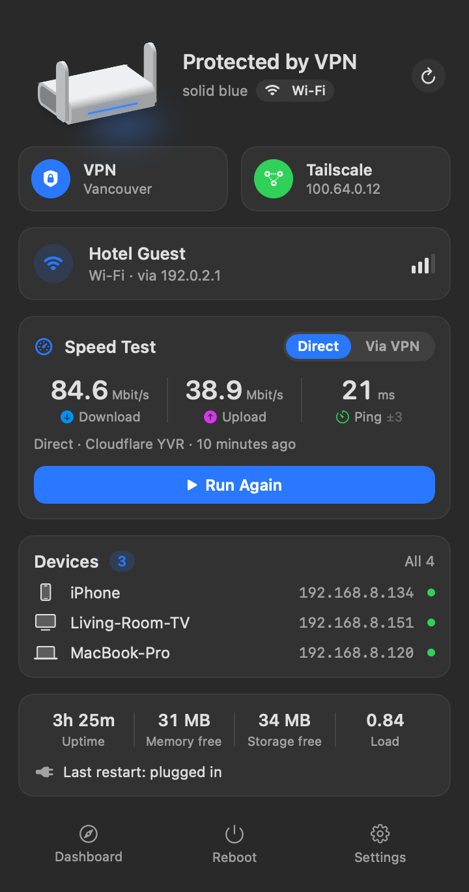
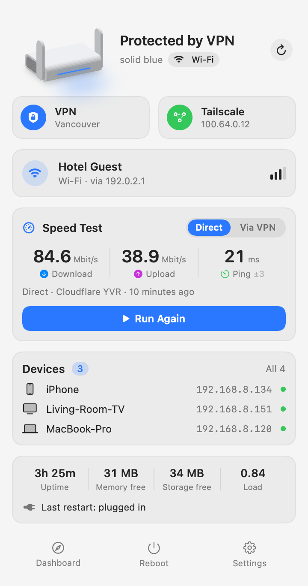

# Opal Router Toolkit

Add-ons for the **GL.iNet GL-SFT1200 (Opal)** travel router, plus **RouterBar**, a native macOS menu bar app to monitor and control it.

<p align="center">
  
  &nbsp;&nbsp;
  
</p>

> Screenshots use made-up demo data.

## What's included

| Component | What it does |
|---|---|
| [**VPN status LED**](docs/vpn-led.md) | The top LED shows whether you're actually protected: **solid blue** = VPN connected, **fast blinking blue** = VPN switched on but not connected, **solid white** = VPN off, **breathing blue** = no internet. A **white/blue alternating** pattern means Tailscale isn't connected. |
| [**Tailscale**](docs/tailscale.md) | Runs Tailscale on the router (128 MB RAM) with compressed memory and a memory guard. Shares the router's LAN with your tailnet, and lets LAN devices reach your tailnet. Reinstalls itself after firmware updates. |
| [**Reboot log**](docs/reboot-log.md) | Records why the router restarted: clean reboot, unplugged, firmware update, or a real **problem** (freeze/crash). Being unplugged, which is normal for a travel router, is never flagged. |
| [**Router helpers + speed test**](docs/router-app.md) | A cheap status command (JSON), a fixed list of allowed actions, and an internet speed test against Cloudflare, either direct or through the VPN. |
| [**RouterBar for macOS**](docs/mac-app.md) | Menu bar app: an animated 3D model of the router whose light mirrors the real LED, VPN and Tailscale controls, connected devices, speed test, router health, and notifications. Works at home over Wi-Fi and anywhere over Tailscale. |

Everything that changes the router is a plain shell script you can read, and each one has an uninstall command at the top.

## Tested on

- GL.iNet **GL-SFT1200 (Opal)**, firmware **4.8.3** (OpenWrt 18.06, SiFlower SF19A28, MIPS, 128 MB RAM)
- macOS 14 or later for RouterBar (built with Xcode / Swift 6)

Other GL.iNet models use different LED hardware and won't work with the LED part as-is. The Tailscale, reboot log, and helper scripts are more portable but untested elsewhere.

## Quick start

1. **Set up SSH key access** to the router as `glrouter` (and optionally `glrouter-ts` over Tailscale). See [docs/ssh-setup.md](docs/ssh-setup.md).
2. **Install the router parts** from the repo root. Each one is optional and independent:

   ```bash
   ssh glrouter 'sh -s' < router/vpn-led/install.sh
   ssh glrouter 'sh -s' < router/reboot-log/install.sh
   ssh glrouter 'sh -s' < router/router-app/install.sh
   sh router/tailscale/install.sh
   ```

   Or run everything at once with `sh router/install-all.sh`.

3. **Install RouterBar.** Either:
   - **Download** `RouterBar-<version>-macOS.zip` from [Releases](../../releases), unzip it, and move `RouterBar.app` to Applications. Because it isn't signed with a paid Apple developer account, macOS blocks it the first time; see [first launch](docs/mac-app.md#first-launch-of-a-downloaded-copy). Or
   - **Build it yourself** (needs Xcode):

     ```bash
     sh mac/RouterBar/build.sh
     ```

   It appears in the menu bar.

## Uninstall

Remove everything from the router and restore stock behavior:

```bash
sh router/uninstall-all.sh --dry-run   # see what would be removed
sh router/uninstall-all.sh             # remove (asks first)
```

Each component's own uninstall command is also at the top of its install script. To remove RouterBar, quit it and delete `/Applications/RouterBar.app` (and `~/Library/LaunchAgents/local.routerbar.plist` if you turned on Launch at Login).

## Firmware updates

With **"Keep Settings"** ticked during a GL.iNet firmware update:

- The LED change reapplies itself at boot.
- Tailscale downloads and verifies its program files again on the first boot with internet (about 4 minutes; the LED shows white/blue meanwhile). Your Tailscale login and approved route are kept.
- The reboot log and router helpers are kept.

Without "Keep Settings", run the install commands again.

## Good to know

- **Change the LAN subnet.** Every GL.iNet router uses `192.168.8.0/24` by default. If you share the router's LAN over Tailscale, pick something uncommon (e.g. `192.168.123.0/24`) so it doesn't clash with other GL.iNet routers or hotel networks.
- **Speed is CPU-bound.** The SF1200 handles about 10–15 Mbit/s through Tailscale, and its HTTPS speed test tops out around 90 Mbit/s. Fine for remote access; not for big transfers.
- **Never read from the LED chip.** The LED controller is write-only. An `i2cget` on it can lock up the I2C bus until a reboot. See [docs/troubleshooting.md](docs/troubleshooting.md).

## Repository layout

```
router/
  install-all.sh          install every router component
  uninstall-all.sh        remove everything, restore stock (has --dry-run)
  vpn-led/install.sh      LED states + Tailscale warning pattern
  tailscale/              installer, auto-reinstaller, memory guard, init script
  reboot-log/install.sh   restart cause logging
  router-app/install.sh   status JSON, allowed actions, speed test (used by RouterBar)
mac/RouterBar/            Swift package + build script for the menu bar app
docs/                     detailed documentation for each part
```

## Security, contributing, changes

The router scripts run as root. [SECURITY.md](SECURITY.md) explains exactly what they change and how to report a vulnerability privately. Bug reports and pull requests are welcome; see [CONTRIBUTING.md](CONTRIBUTING.md). Release history: [CHANGELOG.md](CHANGELOG.md).

## Disclaimer

Not affiliated with or endorsed by GL.iNet, Tailscale, or Cloudflare. "GL.iNet" and "Opal" are trademarks of their owners. The 3D router in RouterBar is an original drawing. These scripts modify a system file of the router firmware (`/lib/functions/gl_util.sh`, with a backup). Use at your own risk.

## License

[MIT](LICENSE)
