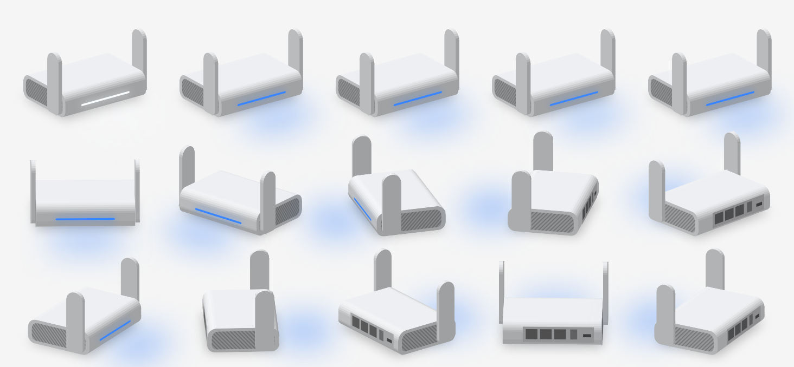
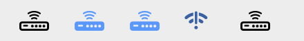
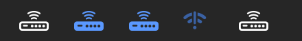

# RouterBar (macOS menu bar app)

`mac/RouterBar/`: a native Swift/SwiftUI app with an AppKit status item. It needs macOS 14+, Xcode, and the [router helpers](router-app.md) installed on the router.

<p align="center"></p>

## Install

**Download:** get `RouterBar-<version>-macOS.zip` from the repository's Releases page. It's a universal app (Apple Silicon and Intel). Unzip it and move `RouterBar.app` to `/Applications`.

**Or build it** (needs Xcode):

```bash
sh mac/RouterBar/build.sh              # build for this Mac, install to /Applications, launch
sh mac/RouterBar/build.sh --no-install # build only (mac/RouterBar/build/RouterBar.app)
sh mac/RouterBar/build.sh --release    # universal build, zipped for a GitHub release
```

It has no Dock icon and lives only in the menu bar.

### First launch of a downloaded copy

RouterBar is signed ad hoc (with the hardened runtime), not with a paid Apple Developer ID, and isn't notarized. So macOS blocks a **downloaded** copy the first time with a warning that Apple can't check it for malicious software. To allow it once:

1. Open `RouterBar.app`. macOS shows the warning; click **Done** (or **OK**).
2. Open **System Settings → Privacy & Security**, scroll to **Security**, and click **Open Anyway** next to RouterBar.
3. Open the app again and confirm.

On macOS 14 you can instead right-click the app and choose **Open**. This right-click shortcut no longer works on macOS 15 and later.

If you prefer the terminal, this removes the "downloaded" flag so it opens normally:

```bash
xattr -dr com.apple.quarantine /Applications/RouterBar.app
```

Builds you make yourself aren't affected.

## Features

- **Menu bar icon that mirrors the router's LED.** Same colors and timing: solid, blinking, breathing, or alternating.
  - "White" uses the menu bar's text color, so it stays visible in light and dark mode.
  - The icon and the 3D model share one clock, so they blink in step.

   

- **A 3D model of the SF1200** drawn by a small built-in renderer (SwiftUI `Canvas`):
  - Real proportions (118 × 85 × 30 mm), rounded body, slatted side vents, front paddle antennas, and the rear port panel.
  - The front light slot glows like the real LED.
  - It sways slowly, and you can **drag to spin it**.
- **VPN and Tailscale tiles:** turn the VPN on/off, restart Tailscale.
- **Internet:** connection type, upstream Wi-Fi name and signal, gateway.
- **Speed test:** direct or through the VPN, with a warning when the router's CPU limited the result.
- **Devices:** online devices with type icons, plus recently seen ones.
- **Router health:** uptime, free memory, storage, load, last restart cause.
- **Footer:** open the dashboard, reboot (asks first), settings (launch at login, Tailscale-only connection, quit).

## Connection

It uses SSH via `/usr/bin/ssh` and your `~/.ssh/config` aliases (see [SSH setup](ssh-setup.md)):

1. `glrouter`: the router's LAN address, at home.
2. `glrouter-ts`: the router's Tailscale address, anywhere. It switches automatically.

The header shows the route in use. **Settings → Connect over Tailscale Only** forces route 2. To change the aliases:

```bash
defaults write local.routerbar localHost my-router
defaults write local.routerbar tailscaleHost my-router-ts
```

It polls `status.sh` every 15 seconds.

## Notifications

They're designed for a travel router that gets unplugged and moved around a lot:

- **Notified:** a PROBLEM restart (freeze or crash), the VPN dropping while switched on, the VPN connecting, Tailscale disconnecting or reconnecting, the router losing or regaining internet, and a new device joining.
- **Not notified:** the router being unreachable (usually just unplugged), clean reboots, unplugs, and any internet, VPN, or Tailscale change during the router's first 3 minutes after starting up.

## Launch at login

**Settings → Launch at Login** writes a per-user LaunchAgent (`~/Library/LaunchAgents/local.routerbar.plist`). That works for a locally built app that isn't notarized.

## Development aids

```bash
APP=mac/RouterBar/build/RouterBar.app/Contents/MacOS/RouterBar
$APP --snapshot /tmp/shots          # render menu (light/dark), 3D model, and icons with live data
$APP --demo --snapshot /tmp/shots   # same with made-up demo data (used for the README images)
```

Source overview:

| File | |
|---|---|
| `RouterBarApp.swift` | AppKit entry point, status item, popover |
| `RouterModel.swift` | Polling, actions, speed test, notifications, launch at login, demo data |
| `SSH.swift` | Runs commands on the router with Wi-Fi → Tailscale fallback |
| `RouterStatus.swift` | JSON models, LED state logic |
| `LEDPattern.swift` | LED timing/colors, shared clock, menu bar icon renderer |
| `Router3DView.swift` | The 3D router renderer |
| `MenuView.swift`, `SpeedTestCard.swift`, `SettingsMenu.swift` | UI |
| `Snapshot.swift` | `--snapshot` rendering |
